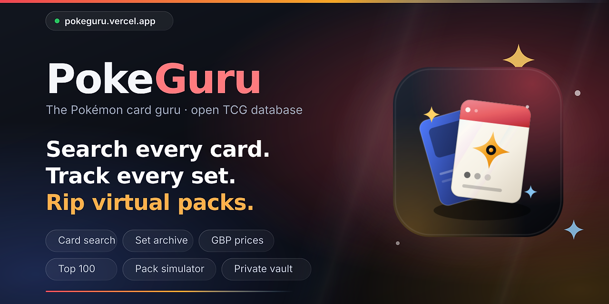

<p align="center">
  
</p>

<h1 align="center">PokeGuru</h1>
<p align="center"><strong>An open Pokémon TCG card database, priced in GBP, that runs in your browser.</strong></p>

<p align="center">
  <a href="https://pokeguru.vercel.app"></a>
  
  
  
  
  
  
</p>

<p align="center">
  <a href="https://pokeguru.vercel.app"><strong>▶ Open the live app — pokeguru.vercel.app</strong></a><br>
  <sub>Vercel is the official deployment. Everything below describes that build.</sub>
</p>

---

## What PokeGuru is

PokeGuru is a fast, installable **Pokémon card collecting** web app for UK
collectors. It searches the full English **Pokémon TCG** card database from
[TCGdex](https://tcgdex.dev/), shows printing-aware Cardmarket reference prices
in GBP with a dated exchange rate, archives every expansion, keeps a private
**Pokémon card collection** in your browser, and includes a free **Pokémon card
opening simulator** built from each set's real card pool.

It is a hobby project with no ads, no accounts, no subscriptions and no paid
tiers — and no API keys to configure.

> **Pricing honesty.** PokeGuru does not invent values, sales, trends or history.
> Every figure comes from a dated marketplace snapshot, and anything the upstream
> API does not publish is shown as **“No Data Available”**. Values are *reference
> prices* — not offers, appraisals, completed sales or financial advice.

---

## Brand and artwork

All PokeGuru artwork is generated from vector sources in this repository, so it
stays crisp at every size and can be regenerated in one command.

| Asset | Source | Output |
| --- | --- | --- |
| Logo mark / favicon | [`assets/logo-mark.svg`](assets/logo-mark.svg) | `public/favicon.svg`, 16/32/48/192 PNGs, `public/icons/apple-touch-icon.png` |
| PWA icons | same mark | `public/icons/icon-192.png`, `icon-512.png`, `icon-maskable-512.png` |
| Social card | [`assets/social-card.svg`](assets/social-card.svg) | `public/og.png` (1200 × 630), `assets/social-preview.png`, `assets/brand/banner-1280x640.png` |

<p align="center">
  
</p>

```bash
npm run brand   # renders every icon, the OG image and the GitHub banner
```

The palette is dark ink (`#08090d`), crimson (`#F04452`) and gold (`#F5A524`);
Space Grotesk is the display face and Inter the body face. The in-app
`BrandMark` component reproduces the same mark inline, so the header, the loading
skeleton and the empty states share one identity.

---

## Features

### Pokémon card search

Search and filter every English card by name, set, collector number, illustrator,
rarity and category. Price-range and printing filters apply to the loaded page
(the search API returns no prices in list results) and the UI says so. Filters
and pagination live in the URL, so results survive a refresh, a deep link and the
Back button.

### Card pages

Large artwork, set and series metadata, illustrator, rarity, regulation marks,
variants, every published Cardmarket price band, a confidence rating for the
headline figure, and optional TCGplayer (USD) reference prices.

### Every set, archived

Browse expansions by series with card counts, release dates and set logos. A
set's total reference value can be computed on demand from each card's own
marketplace snapshot.

### The collection vault

Add, remove, search, sort and value your **Pokémon card collection**; import and
export JSON. Everything lives in `localStorage` (`pokeguru_collection`) on your own
device, old v1.6 collections migrate automatically, and importing merges rather
than deleting.

### Card scanner

Real on-device OCR with Tesseract.js, loaded only when you open the scanner. The
recognised text is matched against the live database and **you** confirm the
match — nothing is added silently.

### Pack opening simulator

Open unlimited virtual **Pokémon card packs** from every era, generated from the
chosen expansion's real card pool with era-specific pack structures. Every pack
panel states whether its structure is documented or estimated, shows the modelled
tier odds with sources, and keeps simulated pulls in their own store
(`pokeguru_pack_sim_v1`) so they can never leak into your real collection. The
opening is staged — a tear, a growing pile of flipped cards, a pull burst graded
by rarity and a one-press “rip again” — and reduced-motion users get the
information without the effects.

### Top 100 by value

A ranked list of the most valuable cards by Cardmarket trend: one printing per
card, raw and ungraded, in GBP with the EUR source figure, the marketplace update
date and the FX rate date. Cards without a real Cardmarket price are excluded,
and the page states exactly how much of the candidate pool has been priced rather
than padding the list.

### Printable flyer

`/flyer` carries the live preview, the download and a print view for standard
5 × 6 in photo paper (`PokeGuru-5x6-QR-Flyer.pdf`) with a QR code that always
points at the production site.

### Offline-tolerant PWA

The app shell is cached, cached data is labelled, updates prompt rather than trap
you on an old build, and installing is optional.

---

## Tech stack

| Layer | Choice |
| --- | --- |
| UI | React 19 + TypeScript, Tailwind CSS 4, Lucide icons |
| Build | Vite (route-level code splitting, no production sourcemaps) |
| Routing | React Router 7 (`BrowserRouter`, real URLs, SPA rewrites) |
| Card data | [TCGdex v2 REST API](https://tcgdex.dev/rest) — no API key |
| FX rates | [Frankfurter v2](https://frankfurter.dev/) — no API key |
| OCR | [Tesseract.js 7](https://github.com/naptha/tesseract.js) (lazy, on demand) |
| PDF / QR | `pdf-lib` + `qrcode-generator` (client-side only) |
| Brand renders | `sharp` (dev-time script only) |
| Tests | Vitest + Testing Library + jsdom |
| Hosting | **Vercel** (official), GitHub Pages (optional mirror) |

No paid services, API keys or subscriptions are required to run or host it.

---

## Project structure

```
PokeGuru/
├── assets/                  # vector brand sources + rendered social assets
│   ├── logo-mark.svg        #   the mark, used for every icon
│   ├── social-card.svg      #   1280 × 640 social layout
│   └── brand/               #   committed PNG banner for GitHub
├── public/                  # favicons, PWA icons, og.png, pwa-capture.js
├── scripts/
│   └── generate-brand-assets.mjs   # renders every icon + social image (sharp)
├── src/
│   ├── components/          # Cards, Flyer, Layout, Packs, Promo, Sets, UI
│   ├── data/                # curated UK set wiki metadata
│   ├── hooks/               # data fetching, collection, page meta, PWA
│   ├── pages/               # 15 routes (home, search, sets, packs, vault, …)
│   ├── pwa/                 # service worker + install prompt
│   ├── services/            # TCGdex, pricing, FX, flyer, SEO/structured data
│   ├── types/               # shared TypeScript types
│   └── utils/               # formatting, URLs, search params
├── tests/                   # Vitest suites (26 files)
├── index.html               # static head: canonical, OG/Twitter, JSON-LD
├── vite.config.ts           # CSP, sitemap.xml, robots.txt, manifest, sw.js
└── vercel.json              # SPA rewrites + security headers
```

---

## Quick start

```bash
git clone https://github.com/DLinacre/PokeGuru.git
cd PokeGuru
npm ci            # install exactly what the lockfile pins
npm run dev       # http://localhost:5173
```

| Script | What it does |
| --- | --- |
| `npm run dev` | Vite dev server |
| `npm run build` | Production build into `dist/` |
| `npm run preview` | Serve the production build locally |
| `npm run typecheck` | `tsc --noEmit` |
| `npm test` / `npm run test:watch` | Vitest suite |
| `npm run lint` | ESLint |
| `npm run brand` | Re-render icons, `og.png` and the GitHub banner |
| `npm run build:pages` | Build the optional GitHub Pages mirror (base `/PokeGuru/`) |

### Configuration

Copy `.env.example` to `.env`, or set the same variables in your host's dashboard.
Every variable is **public** — Vite inlines `VITE_*` at build time, so never put a
secret in one.

| Variable | Required | Purpose |
| --- | --- | --- |
| `VITE_PUBLIC_SITE_URL` | no | Canonical origin (no trailing slash). Defaults to `https://pokeguru.vercel.app`, so a local, mirror or preview build still canonicalises to the official deployment. |
| `DEPLOY_TARGET` | no | `github-pages` builds with the `/PokeGuru/` base path. Leave unset for Vercel and other root-hosted deployments. |

---

## Deployment

### Vercel — official

**<https://pokeguru.vercel.app>** is PokeGuru's one official address.

- Vercel builds `main` through its Git integration and serves the SPA with
  rewrites from [`vercel.json`](vercel.json).
- The build is a plain static Vite build — no server, no functions, no database.
- `vercel.json` also sets the security headers, including a strict CSP that the
  build mirrors as a `<meta>` tag for static hosts.
- All canonical, Open Graph and sitemap URLs are generated from the production
  origin, so preview deployments never present themselves as official.

To deploy your own copy: fork, import the repository into Vercel, and set
`VITE_PUBLIC_SITE_URL` to your domain. Nothing else is needed.

### GitHub Pages — optional mirror

`.github/workflows/deploy.yml` can publish a `/PokeGuru/`-based mirror. It is
manual (`workflow_dispatch`) and secondary: even that build canonicalises to the
Vercel origin and publishes a Vercel-scoped `sitemap.xml`, so search engines are
never shown two competing versions of the site.

---

## SEO

Search-engine plumbing is part of the build, not an afterthought:

- **Unique titles and descriptions** per route, formatted in one place
  (`src/hooks/usePageMeta.ts`) so the site name is appended exactly once.
- **Canonicals** on every route, always against the production origin; query
  strings, filters and hashes are stripped (`src/services/seo.ts`).
- **Indexing directives** — search result views are `noindex,follow`, the 404
  page is `noindex,follow`, everything else is indexable with
  `max-image-preview:large`.
- **Open Graph + Twitter cards** with a 1200 × 630 image, explicit dimensions,
  alt text and `twitter:card=summary_large_image`.
- **Schema.org JSON-LD** — `Organization`, `WebSite` (with `SearchAction`),
  `WebApplication` in the static shell, plus `WebPage`, `FAQPage` (home) and
  `ItemList` (Top 100) per route. Only facts the app actually has are published;
  there are no invented ratings, review counts or prices.
- **`sitemap.xml`** generated at build time (static routes, plus every `/set/:id`
  fetched from TCGdex) with `lastmod`, `changefreq` and priority.
- **`robots.txt`** generated at build time, pointing at the canonical sitemap.
- **Semantic landmarks**, one `h1` per page, `aria-labelledby` section headings,
  descriptive image alt text and a `<noscript>` explanation for crawlers that do
  not run JavaScript.

### Submitting the sitemap to Google Search Console

PokeGuru cannot submit itself, and no one can guarantee indexing — these are the
steps that actually get the site discovered:

1. Open <https://search.google.com/search-console> and add a **URL-prefix**
   property for `https://pokeguru.vercel.app/` (or a **Domain** property if you
   control DNS for the domain).
2. Verify ownership — with Vercel the easiest route is a DNS TXT record or an
   HTML tag added to `index.html`.
3. Go to **Indexing → Sitemaps**, enter `sitemap.xml` and submit. The full URL it
   fetches is `https://pokeguru.vercel.app/sitemap.xml`.
4. Use **URL Inspection** on the home page, `/search`, `/sets`, `/packs` and
   `/top-100`, then **Request indexing** for the ones you care about most.
5. Watch **Pages → Indexed** and **Experience → Core Web Vitals** in the following
   weeks; fix anything reported there rather than re-submitting repeatedly.

Submitting a sitemap is a request to crawl, not a promise of ranking.

---

## Testing

```bash
npm run typecheck && npm run lint && npm test && npm run build
```

The suite covers pricing maths and confidence, cache behaviour, collection
storage and migration, pack generation and rules, the flyer geometry and PDF, PWA
manifest/service worker, routing, URL state and (since v1.9.0) canonical URLs,
title formatting and structured data.

Results for the 1.9.0 release are recorded in
[`RELEASE_NOTES.md`](RELEASE_NOTES.md) and summarised in
[`CHANGELOG.md`](CHANGELOG.md) — including the numbers from the actual run, not
estimates.

---

## Known limitations

- **Prices are reference values.** Cardmarket snapshots arrive via TCGdex and are
  converted with Frankfurter's daily rate; they are not live sale prices and can
  lag the marketplace.
- **English cards only.** The upstream card list this project targets is the
  English set list.
- **The pack simulator is a model.** Pack structures are documented where the
  community has documented them and clearly labelled as estimates where it has
  not; pulls are simulated and carry no monetary value.
- **The vault is local.** Clearing browser data clears the collection — export a
  JSON backup if it matters to you. There is no sync and no account.
- **The scanner is assistive.** OCR quality depends on lighting and card
  condition, and every match must be confirmed by hand.
- **No server-side rendering.** The HTML shell carries the metadata and JSON-LD;
  card and set pages are rendered in the browser, which is why the sitemap lists
  routes rather than pre-rendered pages.

---

## Privacy

No analytics, no advertising, no third-party trackers, no accounts. The
collection and simulator state stay in `localStorage` on your device. Network
requests go to TCGdex (card data and images), Frankfurter (exchange rates) and,
only when you open the scanner, the OCR model files.

---

## Contributing

Issues and pull requests are welcome — see [CONTRIBUTING.md](CONTRIBUTING.md).
Please keep the pricing rules intact: a contribution that invents a price, an
unverified statistic or a claim the data cannot support will not be merged.

## Buy me a pack

PokeGuru is free and always will be. If it saved you an afternoon of spreadsheet
work there is an optional tip link in the footer — it buys nothing in the app.

## Licence

[MIT](LICENSE) © DLinacre. Pokémon and all related names are trademarks of
Nintendo, Creatures Inc. and The Pokémon Company. PokeGuru is an unofficial fan
project, not affiliated with or endorsed by them, and ships no official artwork.

<p align="center"><sub><a href="https://pokeguru.vercel.app">Live app</a> ·
<a href="https://github.com/DLinacre/PokeGuru/issues">Issues</a> ·
<a href="RELEASE_NOTES.md">Release notes</a> ·
<a href="SECURITY.md">Security</a></sub></p>
